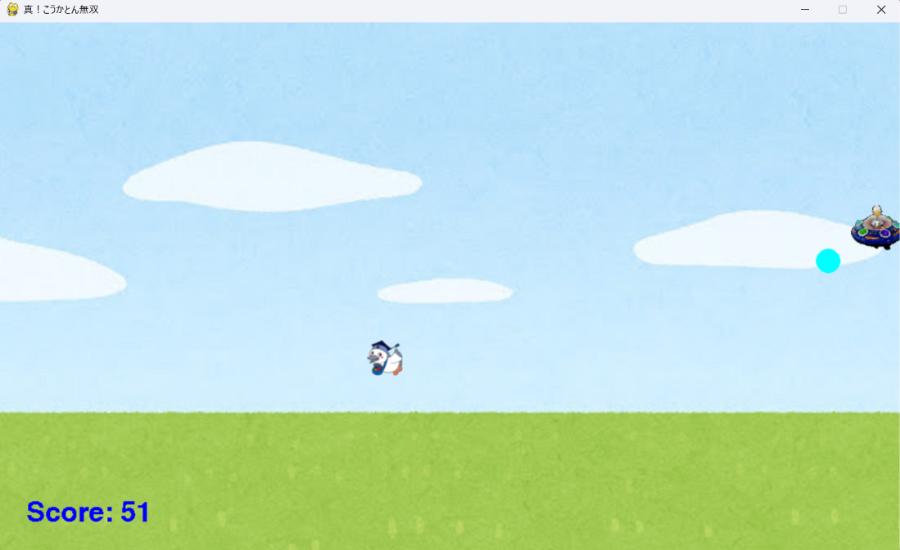

# 真！こうかとん無双

## 概要
PythonとPygameを使用して制作した、2Dシューティングゲームです。

プレイヤーを操作して敵を攻撃し、スコアを獲得しながらゲームを進めます。通常攻撃に加えて、スコアを消費して使用する特殊能力を実装しています。

## ゲーム画面



## 使用技術
- Python
- Pygame

## ゲームの特徴
- プレイヤーを移動させながら敵を攻撃するシューティングゲーム
- ビームによる攻撃機能
- 敵が爆弾を投下する仕組み
- 敵や爆弾を倒すことでスコアを獲得
- スコアを消費して使用する特殊能力
- 爆発などの画像を使用した演出

## 操作方法

| キー | 操作 |
|---|---|
| ↑ ↓ ← → | プレイヤーの移動 |
| Space | ビームを発射 |
| A | 特殊能力を使用（200点消費） |
| 右Shift | ハイパーモードを使用（100点消費） |

## 実行方法

### 1. Pythonのインストール
Pythonがインストールされていることを確認してください。

### 2. Pygameのインストール
ターミナルで次のコマンドを実行します。

```bash
python -m pip install pygame
```

### 3. ゲームの起動
`musou_kokaton.py` があるディレクトリで、次のコマンドを実行します。

```bash
python musou_kokaton.py
```

## ファイル構成

```text
musou-kokaton/
├── README.md
├── musou_kokaton.py
└── fig/
    ├── 3.png
    ├── 6.png
    ├── 8.png
    ├── beam.png
    ├── pg_bg.jpg
    ├── explosion.gif
    ├── alien1.png
    ├── alien2.png
    └── alien3.png
```

※ `fig` フォルダには、ゲームの実行に必要な画像ファイルを配置してください。

## 制作目的
大学の授業で、Pythonを使用したゲーム制作に取り組みました。ゲームの動作や攻撃、スコア管理などの機能を実装することで、プログラミングへの理解を深めました。
